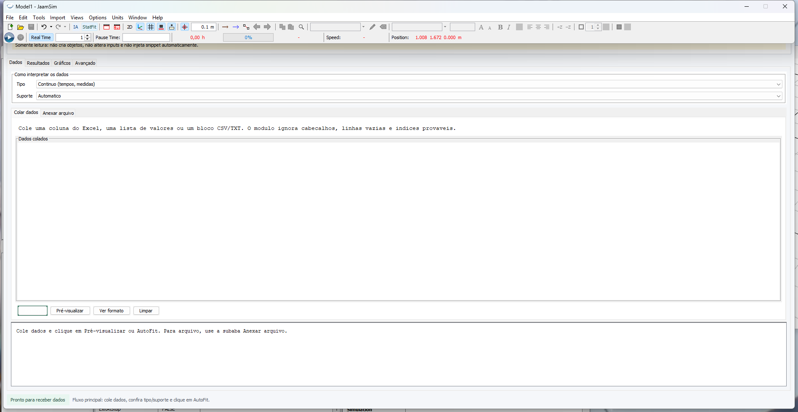
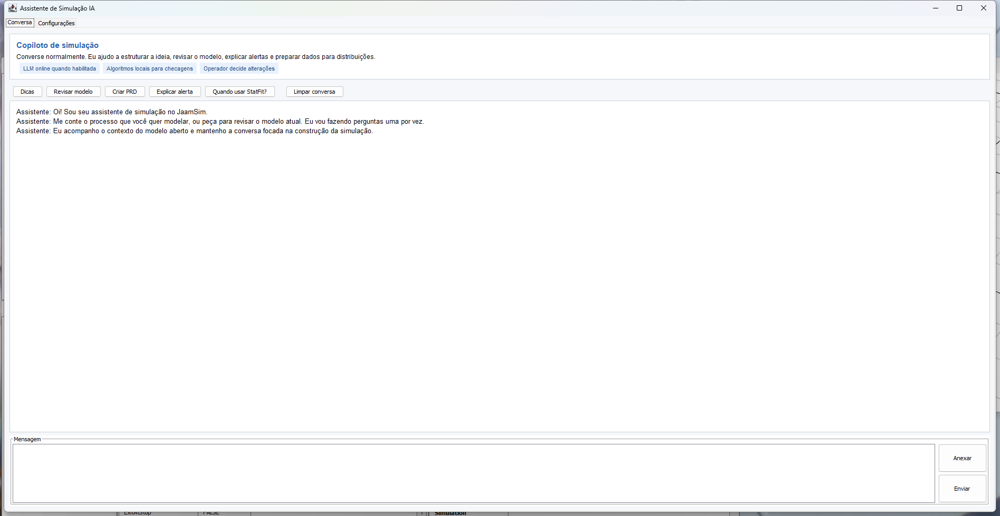
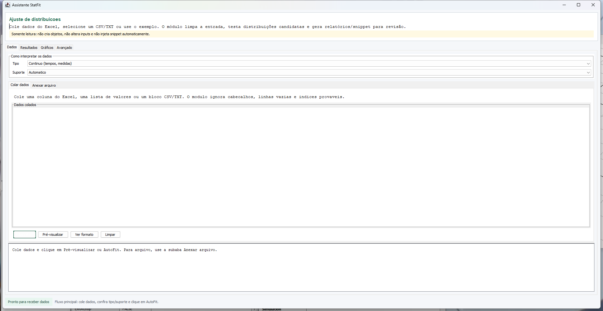

# JaamSim Academic Assistant

Experimental academic fork of [JaamSim](https://github.com/jaamsim/jaamsim) that adds an assistive review layer for discrete-event simulation models.

This repository is based on JaamSim `v2026-03` and contains two optional native tools:

- **AI Simulation Assistant:** deterministic model review, guided briefing, and optional online explanation;
- **StatFit-like Assistant:** local data preparation, descriptive statistics, candidate distribution fitting, plots, and JaamSim snippets.

The evaluated research core is deterministic. Online language models are optional and do not decide whether a model is valid.

> Research status: undergraduate academic prototype. It is not an official JaamSim release, is not endorsed by JaamSim Software Inc., and contains no JaamSim Pro source code.



## Why this fork exists

Simulation software can execute a syntactically valid model while conceptual omissions remain unnoticed. This extension explores a review workflow that makes basic checks explicit and traceable before the operator accepts changes.

The prototype can inspect a structured model snapshot and report conditions such as disconnected flow, queue or process endpoints, unused resources, missing metrics, undocumented decision rules, and insufficient model structure. Every finding identifies the deterministic rule that produced it.

## Central Windows launcher (existing shortcut preserved)

The **original** `RODAR_JAAM_AI_COMPLETO.cmd` belongs to the private
`00_PROJETO_ATUAL` workspace on Google Drive. It has a pinned, historic
v0.50 version and a staged v0.51 candidate that extends the **same file**
with menu options 8-11 (native JaamSim, offline CFG review, report folder,
module status). Existing MC-001 options 1-7 and P004/Full45 DENY restrictions
remain in the central CMD. The user’s existing shortcut stays pointed at
the same path after the private candidate is installed.

**This public repository intentionally does not contain or replace that
2.1 MB self-contained historic launcher.** Its build artifact is only the
`JAAM_AI_NATIVE` Java/Python module to place beside the main CMD.
No alternate Windows launcher is created.

More details: [central integration](docs/academic-assistant/CENTRAL_LAUNCHER.md).

## Architecture

The JaamSim batch evidence and the conceptual review are parallel branches. A `.dat` file is **not** converted into a snapshot.

```text
                                  +-> JaamSim batch -> .dat --------+
JaamSim .cfg ---------------------+                                 +-> evidence report
                                  +-> cfg converter -> snapshot ----+
                                                        -> RCL rules
```

The current public extension contains:

```text
extensions/academic-assistant/
|-- examples/
|   |-- jaamsim/        synthetic .cfg cases
|   |-- snapshots/      controlled JSON snapshots
|   `-- statfit/        synthetic numeric data
|-- python/             deterministic and optional helper scripts
|   `-- tests/
`-- output/             local generated artifacts, ignored by Git
```

See [Architecture](docs/academic-assistant/ARCHITECTURE.md) and [Research scope](docs/academic-assistant/RESEARCH_SCOPE.md).

## Requirements

- JDK 25 for the current JaamSim build;
- Apache Ant 1.10 or later;
- Python 3.11 or later;
- Git.

The public cleanup was verified with Python 3.14.4, JDK 25.0.3, and Apache Ant 1.10.17. The JaamSim runtime still follows the upstream platform requirements.

## Quick start

### 1. Prepare Python tooling

Runtime helpers use the Python standard library. `pytest` is needed only for the test suite.

```powershell
python -m venv .venv
.\.venv\Scripts\Activate.ps1
python -m pip install -r extensions\academic-assistant\requirements-dev.txt
python -m pytest extensions\academic-assistant\python\tests
```

### 2. Build JaamSim

On Windows:

```powershell
.\scripts\build.ps1
```

On Linux or macOS:

```bash
./scripts/build.sh
```

The JAR is written to `build/jars/JaamSim2026-03.jar`.

### 3. Start the custom build

```powershell
java -jar build\jars\JaamSim2026-03.jar
```

When JaamSim starts from the repository root, the extension is discovered automatically. If the JAR is moved elsewhere, set the root explicitly:

```powershell
$env:JAAMSIM_ASSISTANT_ROOT = "C:\path\to\jaamsim\extensions\academic-assistant"
```

Equivalent JVM property:

```text
-Djaamsim.assistant.root=/path/to/jaamsim/extensions/academic-assistant
```

Use `JAAMSIM_PYTHON` or `-Djaamsim.python=...` when `python` is not the desired interpreter.

## Run the deterministic analyzer

Analyze all controlled snapshots:

```powershell
python extensions\academic-assistant\python\snapshot_analyzer.py
```

Review one JaamSim `.cfg` locally:

```powershell
python extensions\academic-assistant\python\modulo_ia_offline.py `
  extensions\academic-assistant\examples\jaamsim\c1_fila_simples_inconsistente.cfg
```

The review produces JSON and Markdown evidence under `extensions/academic-assistant/output/`.

## Run the StatFit-like helper

```powershell
python extensions\academic-assistant\python\statfit_auxiliar.py `
  extensions\academic-assistant\examples\statfit\exemplo_dados_tempos.csv `
  --column tempo_atendimento
```

The module is a screening aid. Distribution selection still requires statistical judgment, domain knowledge, and validation.

## Optional online assistance

The offline rules do not need API keys. Online explanation is opt-in.

1. Copy `extensions/academic-assistant/.env.example` to `extensions/academic-assistant/.env`.
2. Add only the provider variables you intend to use.
3. Keep `.env` local; it is ignored by Git.

Never commit tokens, private models, production data, or personal simulation files. See [SECURITY.md](SECURITY.md).

## Screenshots

### Simulation assistant



### StatFit-like assistant



## Evidence and limits

The controlled evaluation contains reference and inconsistent variants for three synthetic cases:

| Case | Focus | Inconsistent variant |
|---|---|---|
| C1 | simple queue | RCL03, RCL04, RCL07, RCL10 |
| C2 | sequential process | RCL01, RCL02, RCL05, RCL07, RCL09 |
| C3 | decision and rework | RCL06, RCL08, RCL10 |

Reference snapshots produce no alerts in this controlled matrix. This is preliminary evidence, not proof of general validity. The current parser supports a subset of JaamSim configuration constructs, and the rule set can produce false positives or false negatives outside the tested cases.

## Contributing

Read [CONTRIBUTING.md](CONTRIBUTING.md) before opening an issue or pull request. Changes should preserve:

- deterministic findings as the primary decision path;
- human confirmation before model modification;
- reproducible tests for every rule or parser change;
- a strict boundary between offline analysis and optional network calls;
- upstream JaamSim attribution.

## Upstream and attribution

JaamSim is developed by JaamSim Software Inc. The original project, documentation, citation guidance, and releases are available at:

- <https://github.com/jaamsim/jaamsim>
- <https://jaamsim.com>

The original upstream README is preserved at [docs/UPSTREAM_README.md](docs/UPSTREAM_README.md). Modified files are listed in [CHANGES.md](CHANGES.md).

## License

This fork is distributed under the Apache License 2.0, consistent with the upstream project. See [LICENSE](LICENSE) and [NOTICE](NOTICE).
